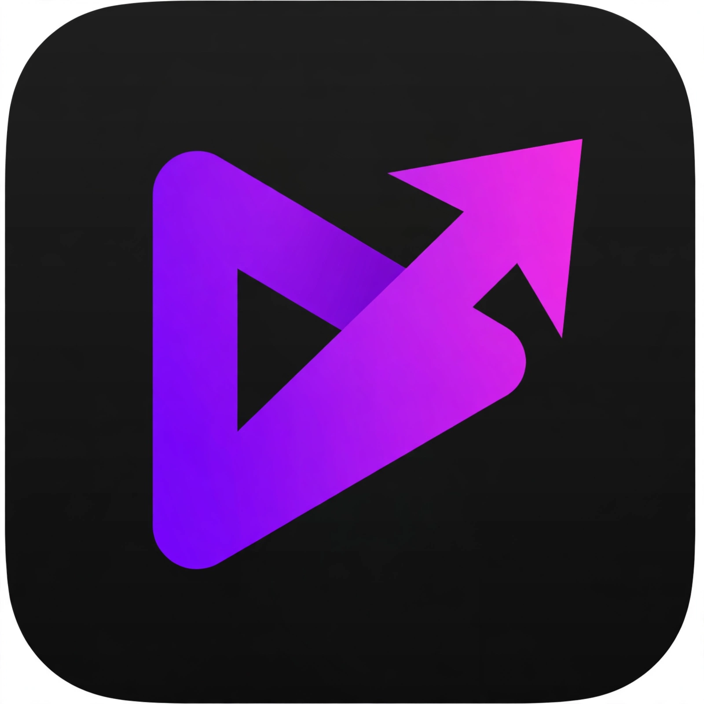
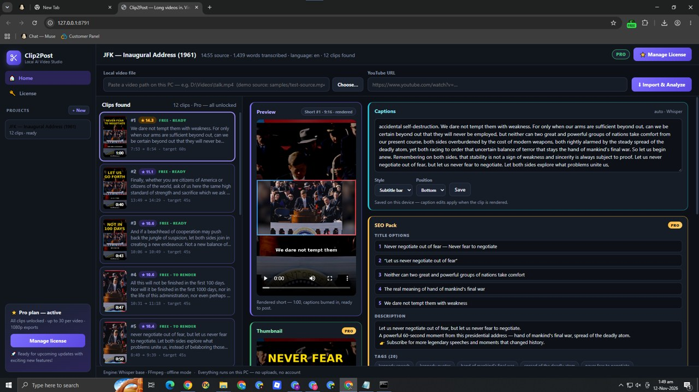
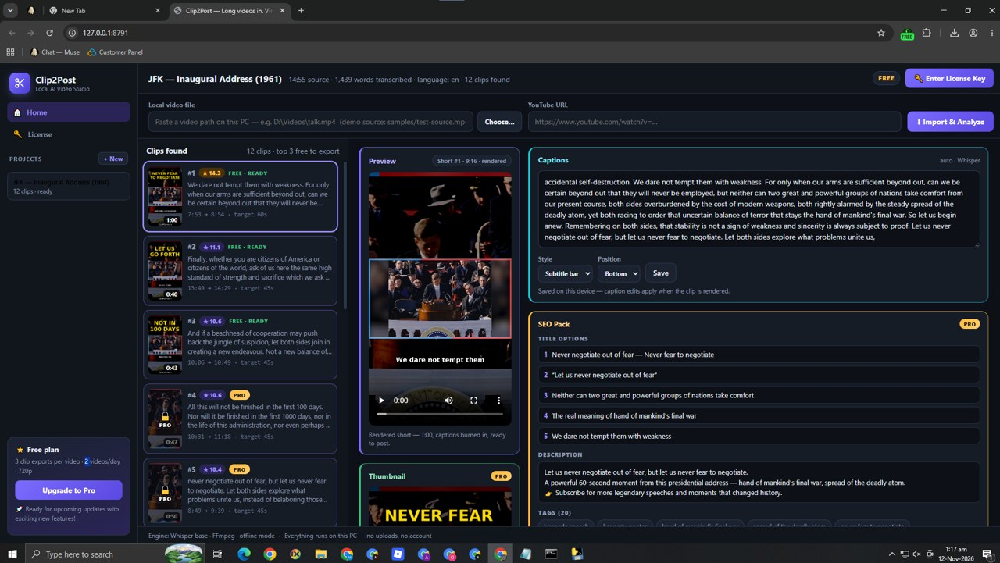

  

<h1 align="center">Clip2Post</h1>

  <b>Long videos in. Viral Shorts out.</b> 
  A local AI video studio for Windows that turns one long video into ready-to-post
  vertical Shorts — with captions, an SEO pack and a thumbnail for every clip.

  
  
  
  

  

---

## What is Clip2Post?

Clip2Post listens to your long video with on-device speech recognition
(Whisper), finds the strongest moments, and renders them as vertical
**9:16 Shorts with burned-in captions**. For every clip it also prepares a
complete posting pack — **5 title options, a description, tags and
hashtags** — plus a bold thumbnail.

Everything runs **on your own PC**. No uploads, no account, no cloud
rendering queue, no waiting. Your videos never leave your machine.

## Key features

- 🎬 **Automatic clip finding** — speech is transcribed and scored;
  the best moments are ranked, strongest first
- 💬 **Word-accurate captions** — burned into every render, editable
  before export
- 🔍 **SEO pack for every clip** — 5 titles, description, 20 tags,
  5 hashtags (never spammy, always on-topic)
- 🖼️ **Thumbnail generator** — a punchy frame + big text, ready to post
- 📥 **Import anything** — a local file, or a single YouTube link
- 🛑 **Full control** — stop any job, delete projects, re-render any
  single clip
- 🔑 **Simple licensing** — one key, one PC, with a 14-day offline grace
  period
- 🎥 **Facecam Reaction** *(preview in 1.0, recording in development)* —
  react to your own clips on camera

## Free vs Pro

| | **Free** | **Pro** |
|---|---|---|
| Clips per video | Top 3 | All — up to 30 |
| Videos per day | 3 | Unlimited + bulk channel / playlist import |
| Resolution | 720p | 1080p |
| SEO pack & thumbnails | Top clips | Every clip |
| Price | $0 | **$7/mo · $49/yr · $39 lifetime** |

## How it works

1. **Import** — drop in a local file or paste one YouTube link
2. **Transcribe** — Whisper converts speech to word-timed text, locally
3. **Detect** — moments are scored (hooks, questions, strong statements)
   and ranked
4. **Render** — 9:16 crop with blur-pad, captions burned in, SEO pack
   and thumbnail generated

> Clips are made from **speech**. Talks, stories, podcasts, commentary
> and lessons work best. A video with no speech (music only) will
> honestly report 0 clips — Clip2Post always tells you why.

## Screenshots

  

## Download & install

**[Get Clip2Post → clip2post.lemonsqueezy.com](https://clip2post.lemonsqueezy.com)**

> 🚀 **Launch status:** the store is in its final activation review —
> sales open the moment it clears. The product itself is finished and
> in daily use.

1. Run **Clip2Post-Setup.exe** — it installs per-user (no admin rights
   needed) into `%LocalAppData%\Clip2Post`
2. On the last screen, tick **"Run first-time setup now"** — this
   installs the Python packages and downloads the speech model
   (~140 MB, one time, internet required)
3. Launch **Clip2Post** from your desktop and import your first video

**Requirements:** Windows 10/11 · Python 3.13 (the setup guides you if
it's missing) · ~2 GB free space · internet for first-time setup,
YouTube imports and license checks

Full instructions: **[User Guide](docs/USER-GUIDE.md)**

## Pricing

| Plan | Price | |
|---|---|---|
| Pro Monthly | **$7** / month | All Pro features, 1 PC |
| Pro Yearly | **$49** / year | Save 41% vs monthly |
| Pro Lifetime | **$39** once | Pay once, use forever — all future updates included |

One key works on **one PC**. Moving computers? Deactivate in the app,
activate on the new one — no support ticket needed.

## Tech stack

- **Python** core (local HTTP app, zero-framework UI server)
- **faster-whisper** — on-device speech-to-text (base model, CPU int8)
- **FFmpeg** — rendering, captions burn-in, thumbnails
- **yt-dlp** — YouTube imports
- **Vanilla HTML/CSS/JS** — the interface, no build step
- **Inno Setup** — the Windows installer
- **Lemon Squeezy** — payments & license keys (1 activation per key,
  enforced server-side)

## Roadmap

- 🎥 Facecam Reaction **recording** (camera + your voice, auto-ducking)
- 🤖 AI SEO packs (bring your own Gemini key — richer titles & hooks)
- 📤 One-click upload & scheduling to YouTube / TikTok / Facebook
- 🌍 Caption translation for multi-language Shorts

## FAQ

**Is my video uploaded anywhere?**
No. Transcription, detection and rendering all happen on your PC.

**Which videos work best?**
Anything with clear speech — podcasts, talks, stories, lessons,
commentary. Music-only videos produce no clips (and the app says so).

**Can I use one license on two PCs?**
One key activates one PC at a time. Deactivate in the app to move it.

**Does it work offline?**
Yes for local files, after the one-time setup. Pro stays active for
14 days without internet before it needs a quick check-in.

## License

Clip2Post is **commercial software**. This repository is the official
product showcase and documentation; the source code is not published,
so the licensing system that honest customers pay for stays intact.
© Clip2Post. All rights reserved. See [LICENSE](LICENSE).

---

  <b>Clip2Post</b> — Local AI Video Studio 
  <a href="https://clip2post.lemonsqueezy.com">clip2post.lemonsqueezy.com</a>

